# Twitter 情感数据清洗与探索性分析技术报告

**课程**：DSAI4205　**数据来源**：`Data 5 - Twitter`　**版本**：v1.0（2026-11-04）

---

## 摘要

本报告基于 `Data 5 - Twitter` 提供的 Twitter 情感语料（原始训练集 596 条、测试集 397 条），对原始数据进行系统性清洗，并在清洗后的数据上完成探索性分析（EDA）与基线分类建模。

清洗环节识别并处理了六类数据质量问题，其中**编码损坏**（UTF-8 以 Latin-1 误读导致的乱码）是最隐蔽的一类。清洗后训练集 591 条、测试集 397 条，无空文本，词表从 3367 个降至 2699 个，平均词数从 21.24 降至 20.50，说明删除的主要是网址、乱码与占位符，正文信息基本保留。

EDA 表明：训练集与测试集为同一分布；篇幅不能稳定区分情感；问号、`@`、网址、感叹号四类表层特征与情感类别存在中等关联（Cramer's V 约 0.15–0.30）；四类情感呈现各自鲜明的写法画像。基线模型（TF-IDF 1–2 元词 + 逻辑回归）在测试集上取得 **accuracy 0.506、macro-F1 0.466**，显著高于"永远猜最多类"的参照（0.302 / 0.116），为后续模型提供了可比基准。

---

## 1. 项目背景与数据概况

### 1.1 任务定义

每行是一条推文，对应一个情感标签，粒度为"一条推文 → 一个标签"。原始数据说明标注的是**实体级情感**：给定一条消息和一个实体，判断该消息对该实体的情感。实际文件中没有独立的实体列，实体信息内嵌于正文，通常是 `@账号` 或品牌名（如 NBA 2K、Amazon、Verizon、Johnson & Johnson）。

| 标签 | 含义 |
| --- | --- |
| 0 | Negative（负面） |
| 1 | Positive（正面） |
| 2 | Irrelevant（无关） |
| 3 | Neutral（中性） |

### 1.2 原始数据规模与格式

| 项目 | 训练集 | 测试集 |
| --- | ---: | ---: |
| 行数 | 596 | 397 |
| 缺失值 | 0 | 0 |
| 标签越界 | 无 | 无 |
| 标签类型 | 浮点数（`0.0`） | 整数 |

两个划分均无缺失值，标签全部落在 0–3。训练集标签以浮点数形式存储、测试集为整数，清洗时已统一为整数。原始正文整体很短：训练集清洗前平均约 21 个词，最短 5 个词，最长 65 个词。

---

## 2. 原始数据质量问题诊断

对原始数据逐条扫描后，共识别出以下问题（计数经与原始文件独立复核，与 `eda_stats.json` 一致）：

| 问题 | 训练集 | 测试集 | 处理策略 |
| --- | ---: | ---: | --- |
| 非 ASCII / 编码损坏 | 99 行 | 74 行 | 可还原的字符修复，其余删除 |
| 含网址 | 122 行 | 88 行 | 从正文删除，保留"是否有网址"标记 |
| 含 `@` 账号 | 166 行 | 115 行 | 正文替换为统一记号，账号名另行保存 |
| `<unk>` 占位符 | 26 行 | 5 行 | 删除 |
| `RhandlerR` 打码占位符 | 6 行 | 13 行 | 删除 |
| 字母被拉长（sooo） | 15 行 | 20 行 | 连续 3 次及以上压缩为 2 次 |
| 完全重复的推文 | 1 句出现 5 次 | 0 | 保留 1 次 |
| 训练/测试跨划分重复 | 1 句 | 同一句 | 从训练集删除，测试集保留并标记 |

### 2.1 编码损坏（最隐蔽的问题）

弯引号被存储成了乱码。典型例子：`I’m` 实际是 `I'm`。处理规则分三级：

- **完整序列**（如 `I'm` 的弯引号）：通过 `ftfy` 完整还原；
- **末字节已丢失为 `?`**：仅在缩写位置补回撇号（如 `can't`），其余乱码删除；
- **表情符号**：先还原为文字（如 `shrug`），再进入后续清洗流程。

### 2.2 重复句与标签冲突

重复句有两处，且都存在标签不一致：

1. `At the same time, despite the fact that there are currently some 100 million people...` 在训练集出现 5 次（4 次 Negative、1 次 Neutral）。按多数保留 1 条 Negative。该句读起来更像新闻陈述，多数标签仍可能标注有误，但**清洗环节不人为修改标签**。
2. `It is not the first time that the EU Commission has taken such a step.` 训练集标为 Negative、测试集标为 Neutral。该句从训练集删除，避免模型"先见过"；测试集原行保留并标记 `cross_split_overlap = 1`，评估时建议将其从主指标中单独说明。

### 2.3 超长文本

以训练集词数的四分位距定义阈值：超过 **58.5 个词**记为长文本。训练集 3 条、测试集 4 条，均为完整的长投诉或长说明，**予以保留**（详见 5.9 节）。

### 2.4 类别平衡

清理后的类别比例在两个划分中接近，Irrelevant 类最少，最多类约为最少类的 1.6 倍，属于**轻度不平衡**：

| 类别 | 训练集 | 占比 | 测试集 | 占比 |
| --- | ---: | ---: | ---: | ---: |
| Negative | 174 | 29.4% | 120 | 30.2% |
| Positive | 165 | 27.9% | 106 | 26.7% |
| Irrelevant | 106 | 17.9% | 66 | 16.6% |
| Neutral | 146 | 24.7% | 105 | 26.4% |
| **合计** | **591** | 100% | **397** | 100% |

> **策略**：清洗阶段不做重采样，以免改变真实分布；测试集亦不可重采样。后续模型比较应优先采用 **macro-F1**，而非仅看 accuracy。

---

## 3. 数据清洗流程设计

训练集与测试集使用**同一套固定顺序的规则**，保证可复现性与一致性：

1. **标签规范化**：转为整数，并映射出 Negative / Positive / Irrelevant / Neutral 四类。
2. **编码修复**：修复乱码；可恢复的表情转成单词。
3. **统一小写**。
4. **删除网址**：感叹号数、问号数、网址数、大写比例在删除前已记录为独立特征列。
5. **`@` 账号替换**：正文统一替换为 `atmention`；原账号小写后写入 `entities` 列（以 `|` 分隔）。账号种类多且稀疏，留在正文主要是噪声；品牌若以单词写出（`amazon`、`verizon`）则原样保留。
6. **删除占位符**：移除 `<unk>` 与 `RhandlerR`。
7. **展开缩写**：使否定单独成词，如 `don't → do not`、`can't → can not`、`I'm → i am`。
8. **去除标点**。
9. **去除纯数字**：长度 ≥ 6 的纯数字（账号编号一类）删除。
10. **词形还原**：`played → play`、`disappointed → disappoint`；功能词（`not`、`no`、`us`、`as` 等）保持原样——WordNet 会把 `us` 错误还原成 `u`，故功能词不参与还原。
11. **去重与跨划分处理**：精确重复只留一行，标签冲突取多数标签；跨划分的一句仅从训练集移除。

### 关键设计说明：停用词保留

停用词**保留在 `text_clean` 中**。否定词（`not`、`no` 等）本身就是情感信号，删除会直接损害分类。词云与高频词图为了内容可读性，只在**画图时**隐去 `the`、`to`、`of` 一类词，图内 `not` 仍保留。**建模请使用 `text_clean`，不要使用词云中的词表。**

---

## 4. 清洗结果与效果评估

### 4.1 关键指标

| 指标 | 清洗前 | 清洗后 |
| --- | ---: | ---: |
| 训练集行数 | 596 | 591 |
| 测试集行数 | 397 | 397 |
| 被删除行数 | — | 5 |
| 训练集词表（字母词） | 3367 | 2699 |
| 训练集平均词数 | 21.24 | 20.50 |
| 空文本数 | — | **0** |

清洗共删除 5 行（4 行重复句 + 1 行跨划分重叠），其余问题均在行内修复。词表缩减约 20%、平均词数仅下降 0.74，印证删除的主要是网址、乱码与占位符，**正文信息基本无损**。

### 4.2 清洗效果示例

| 原文 | 清洗后 |
| --- | --- |
| `I’m getting really disappointed with @PlayOverwatch ...` | `i am get really disappoint with atmention ...` |

---

## 5. 探索性数据分析（EDA）

图表位于 `figures/`（`01`–`12`），对应数据表位于 `reports/`。

### 5.1 训练集与测试集为同一分布

- **类别比例**：卡方检验 χ² = 0.70，p = 0.87；
- **篇幅分布**：Mann-Whitney 检验 p = 0.97；
- **中位词数**：训练集 17，测试集 18（图 `01_class_distribution.png`、`03_length_train_test.png`）。

两个划分的类别结构与篇幅分布一致，可直接"训练集学习、测试集评估"。唯一需单独处理的只有 2.2 节所述那条标签冲突的重叠句。

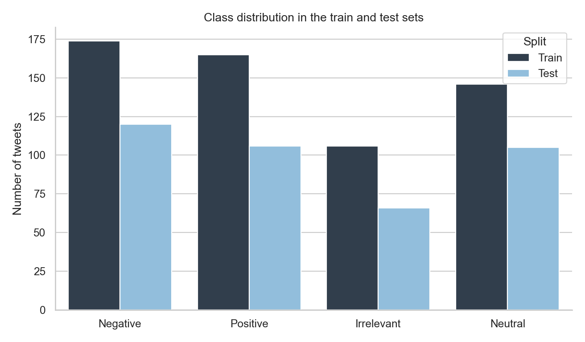

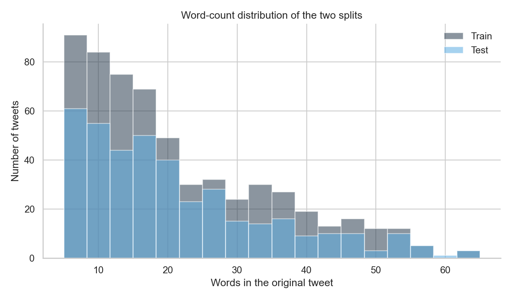

### 5.2 篇幅不能稳定区分情感，表层写法可以

训练集内 Positive 中位词数 14、Negative 19（Kruskal-Wallis p = 0.028），但测试集四类中位数 16.5 / 17 / 19 / 19（p = 0.105），长度差距未在测试集重复出现（图 `02_length_by_sentiment.png`）。**长度适合描述数据，不宜当作稳定特征。**

标点与账号的差异在两个划分中方向一致。下表为"该类推文出现该特征的占比"，Cramer's V 约 0.15–0.30（图 `04_surface_features.png`，`reports/association_tests.csv`）：

| 特征 | 训练集 | 测试集 |
| --- | --- | --- |
| 问号 | Negative 25.9%，Positive 9.1% | Negative 25.0%，Positive 7.5% |
| `@` 账号 | Negative 39.1%，Neutral 17.8% | Negative 44.2%，Positive 20.8% |
| 网址 | Neutral 38.4%，Irrelevant 28.3%，Negative 8.6% | Irrelevant 31.8%，Neutral 30.5%，Negative 14.2% |
| 感叹号 | Negative 最低（10.9%），Neutral 26.0% | Negative 最低（10.8%），Positive 26.4% |

**解读**：负面推文更常提问、更常点名账号，内容多为要求客服或厂商处理问题；中性与无关推文更常带链接，接近转发与新闻；感叹号在正面推文中更多，对应兴奋的表达。大写、拉长词、`<unk>` 与超长文本和类别无稳定关系。

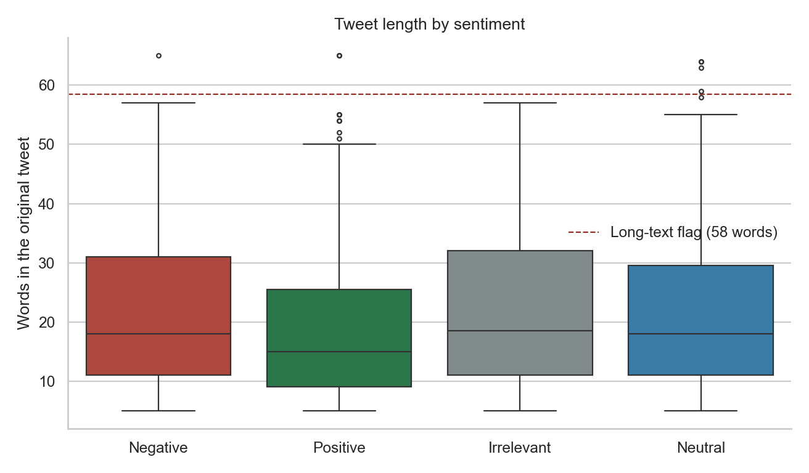

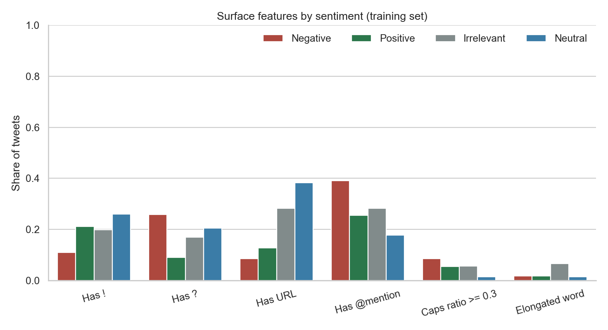

### 5.3 数值特征之间基本正交

情感是四类名义变量，与文本特征的关系由 5.2 的类别关联刻画；数值列之间用 Pearson 相关（图 `09_feature_correlation.png`）：

| 一对特征 | r |
| --- | ---: |
| 词数，字符数 | **0.95** |
| 字符数，`@` 个数 | 0.30 |
| 感叹号数，大写比例 | 0.28 |
| 词数，`@` 个数 | 0.24 |
| 字符数，问号数 | 0.21 |
| 网址数，其余任一列 | ≤ 0.15 |

词数与字符数相关 0.95，是同一信息的两计数方式；其余相关均很弱。**问号、感叹号、网址、`@` 四个特征可同时保留，彼此没有替代关系。**

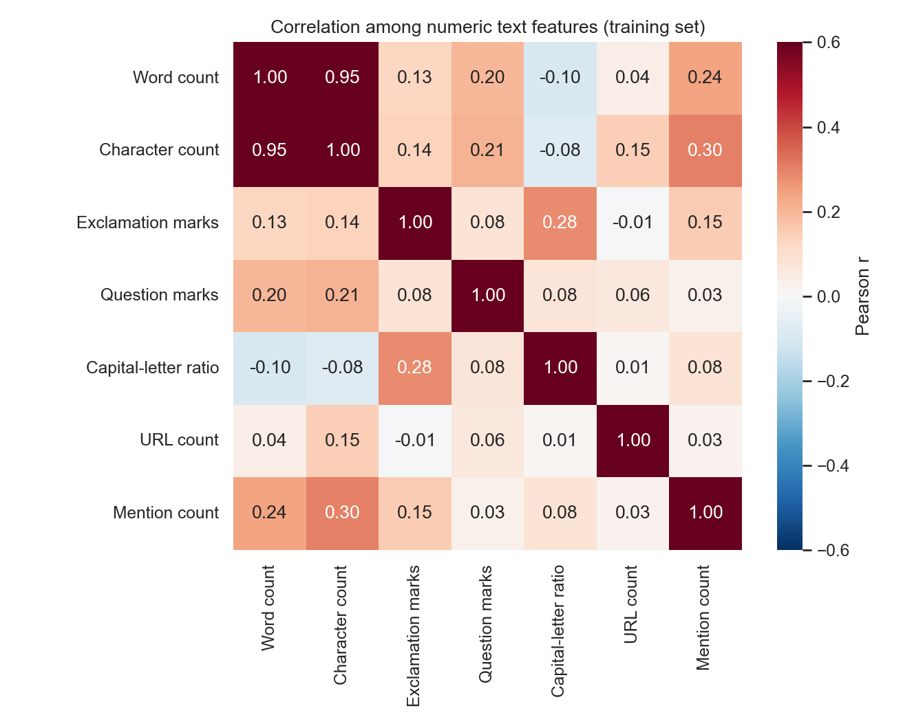

### 5.4 四类情感的画像

下表为训练集；颜色图见 `10_class_profile.png`（格内为原值，颜色表示该值相对四类均值的高低）。数据对应 `reports/class_profile.csv`：

| 指标 | Negative | Positive | Irrelevant | Neutral |
| --- | ---: | ---: | ---: | ---: |
| 推文数 | 174 | 165 | 106 | 146 |
| 平均词数 | 22.94 | 19.10 | 22.31 | 20.84 |
| 含否定词 | 37.4% | 18.2% | 19.8% | 19.2% |
| 含问号 | 25.9% | 9.1% | 17.0% | 20.5% |
| 含感叹号 | 10.9% | 21.2% | 19.8% | 26.0% |
| 含 `@` | 39.1% | 25.5% | 28.3% | 17.8% |
| 含网址 | 8.6% | 12.7% | 28.3% | 38.4% |
| 含游戏词 | 41.4% | 40.0% | 45.3% | 27.4% |
| 含品牌词 | 13.8% | 10.3% | 6.6% | 28.8% |

> 游戏词含 game、play、xbox、pubg、fifa 等；品牌词含 amazon、verizon、johnson、microsoft、nvidia 等。一条推文可同时计两类。

四类呈现四种写法：

- **Negative（点名投诉）**：否定最多，问号与 `@` 最多，网址最少；
- **Positive（赞赏）**：篇幅最短，否定与问号最少，感叹号较多；
- **Irrelevant（玩家讨论）**：游戏词最多（45.3%），品牌词最少（6.6%），更像赛程、玩家与版本讨论；
- **Neutral（新闻转述）**：品牌词与网址最高，游戏词最低，更像产品新闻。

否定词出现在 37.4% 的负面推文中，其余三类均在 18%–20%。**"否定词"比"感叹号代表生气"更稳定可靠。**

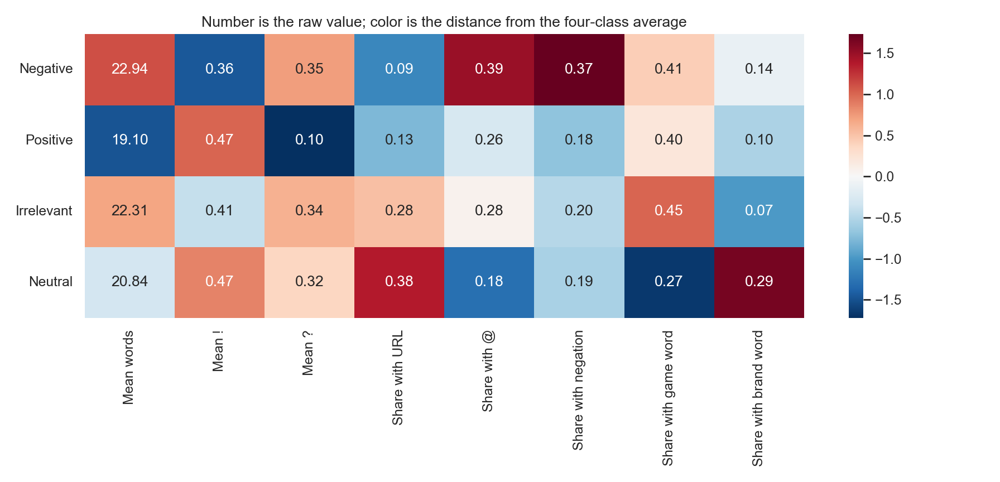

### 5.5 高频词与真正有区分度的词

直接词频统计时，`game`、`get`、`play` 在多个类别中都位居前列（图 `05_top_words_by_class.png`、`08_wordclouds.png`）——词频高只说明大家都在谈论游戏。将每一类与其余三类比较后（对数优势比，图 `11_distinctive_words.png`），才能得到属于该类的信号词；进入排序要求该词至少出现在该类 4 条推文中：

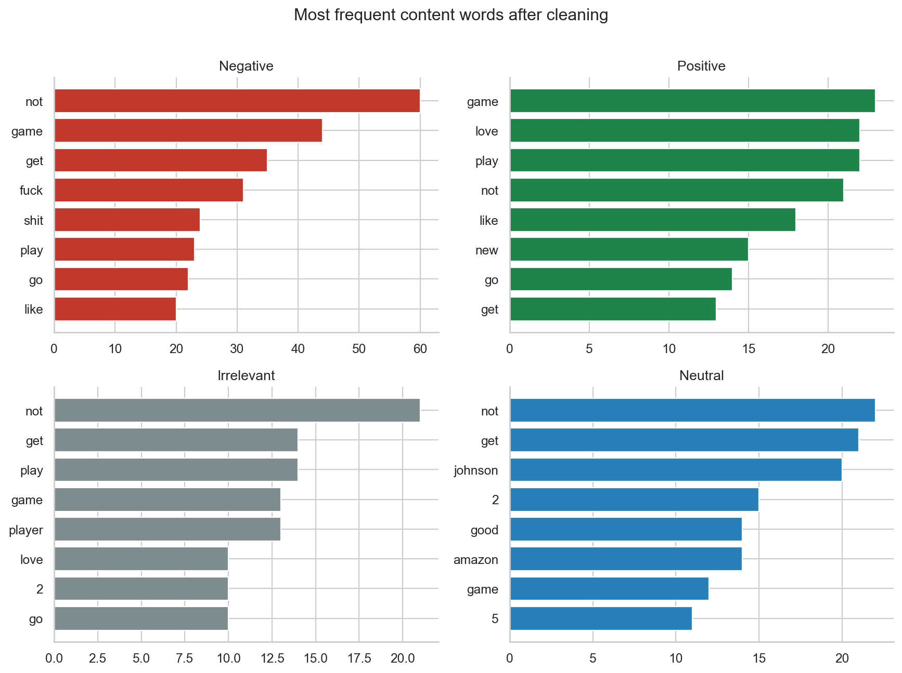

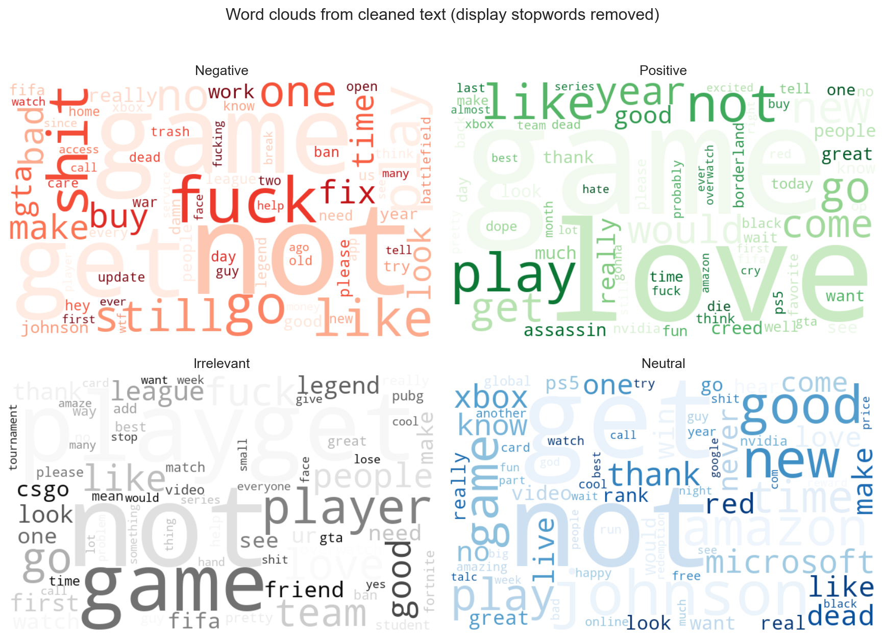

| 类别 | 更像该类的词 | 该类中使用该词的推文 |
| --- | --- | --- |
| Negative | fuck，shit，not，fix，bad，buy | `not` 50/174（28.7%），`fuck` 22/174（12.6%），`fix` 12/174（6.9%） |
| Positive | love，new，favorite，assassin，creed | `love` 19/165（11.5%），`new` 15/165（9.1%） |
| Irrelevant | player，csgo，team，overwatch，legend | `player` 10/106（9.4%），`team` 7/106（6.6%） |
| Neutral | johnson，amazon，microsoft，news，global | `amazon` 12/146（8.2%），`johnson` 10/146（6.8%），`microsoft` 8/146（5.5%） |

**注意**：`assassin` / `creed` 是大量正面评论集中在同一款游戏所致，属话题扎堆而非通用的褒义词；Irrelevant 尾部的 `mean`、`add`、`match` 各仅 4 条推文，排序可参考但不宜赋予过高权重。

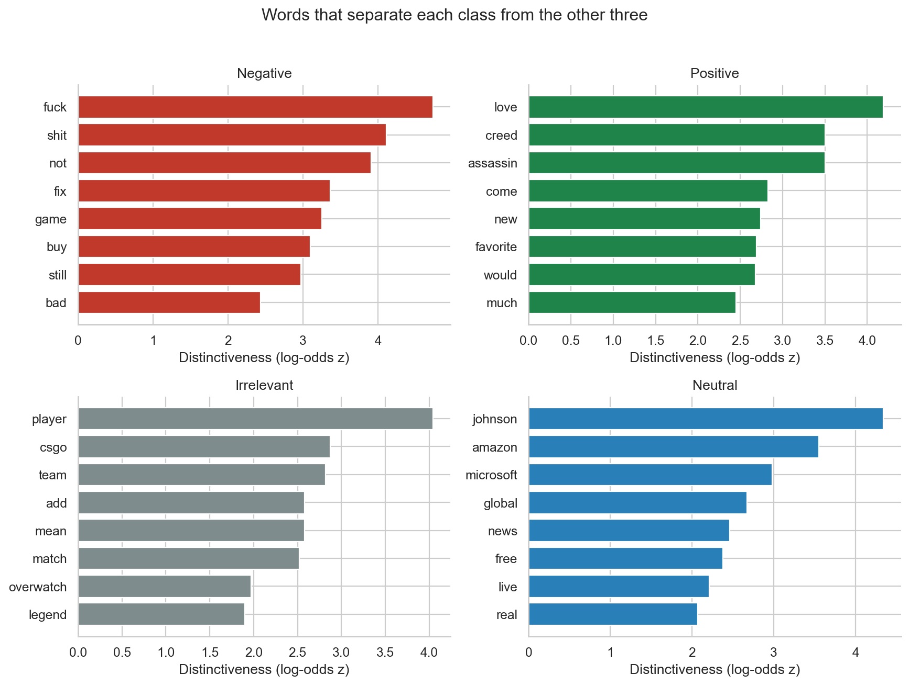

二字短语同样以产品名为主：Call of Duty、Black Ops Cold War、Red Dead Redemption、Assassin's Creed、League of Legends、Home Depot。带情绪的短语次数很少——Negative 的 `not work` 仅 4 次，Positive 的 `game love`、`much fun` 各 3 次（图 `06_top_bigrams.png`）。Johnson & Johnson 在 Negative 中出现 5 次、在 Neutral 中出现 8 次，**同一品牌两边都出现，仅记品牌名会把投诉与新闻混在一起。**

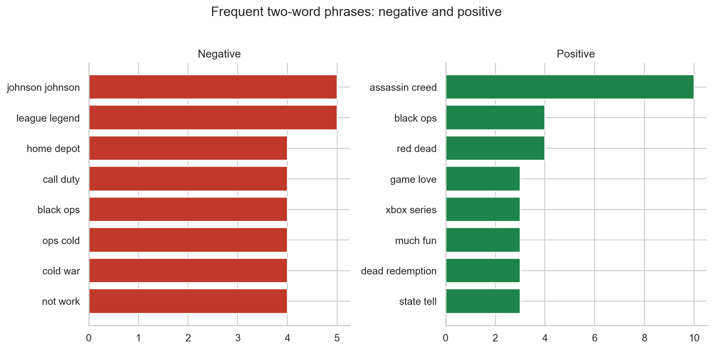

### 5.6 类间词表重叠

只保留在某一类至少出现于 3 条推文的内容词，再计算两类词表的 Jaccard 系数（图 `12_vocab_overlap.png`）：

| | Positive | Irrelevant | Neutral |
| --- | ---: | ---: | ---: |
| **Negative** | 0.26 | 0.22 | 0.25 |
| **Positive** | — | 0.32 | 0.30 |
| **Irrelevant** | — | — | 0.24 |

重叠约在四分之一到三分之一。Positive 与 Irrelevant 共享最多（0.32），Negative 与 Irrelevant 共享最少（0.22）。**Irrelevant 难分，主要因为它与正面讨论共用同一批游戏词，而自身缺少 `love` 这类稳定的情绪词。**

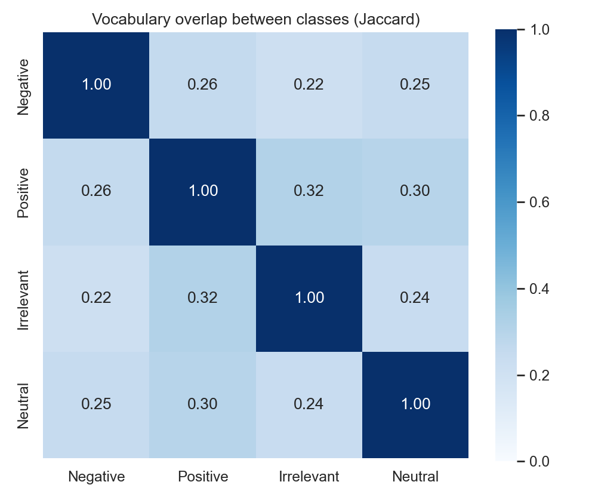

### 5.7 被点名的账号

训练集中出现至少 4 次的账号（图 `07_entity_sentiment.png`，`reports/top_entities.csv`）：

| 账号 | 提及次数 | 情感分布 |
| --- | ---: | --- |
| `@nba2k` | 16 | 11 次 Negative |
| `@eamaddennfl` | 11 | 8 次 Negative |
| `@rainbow6game` | 6 | 5 次 Negative |
| `@verizon` | 7 | 4 次 Negative |
| `@borderlands` | 4 | 3 次 Positive（少数偏正面） |

单账号样本只有几条到十几条。这能说明语料集中于游戏和少数消费品牌，**不能单独当作某个品牌的口碑结论。**

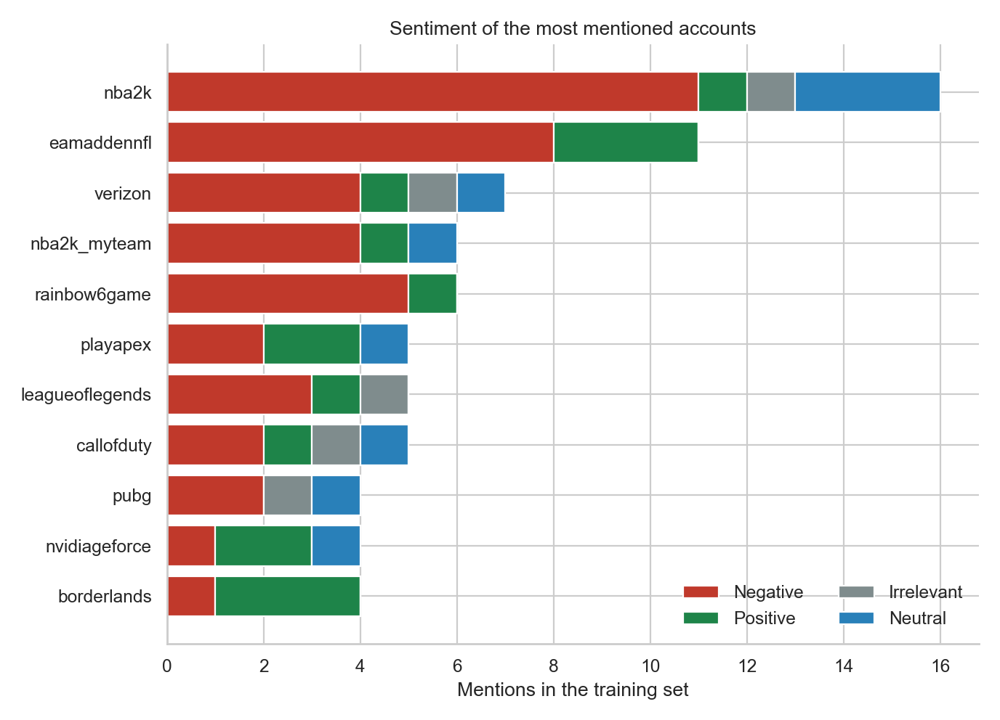

### 5.8 超长文本均为完整推文

超过 58.5 个词的有训练集 3 条、测试集 4 条，原文见 `reports/long_tweets.csv`，均为完整内容：Borderlands 纹身喜爱、Amazon 笔记本促销、给 Call of Duty 的产品建议、对发售日的质问。其中测试集 `test_385` 标注为 Neutral，正文却在抱怨 Ghost Recon "trash""still no"。**超长文本本身是有效样本；个别标签与措辞不符，清洗时未改标签。**

---

## 6. 基线模型

脚本为 `models/kai/tfidf-lr/baseline_tfidf_lr.py`，训练集 591 条、测试集 397 条，输入为 `text_clean`。

- **特征**：TF-IDF（1–2 元词，`min_df=2`，`sublinear_tf`），词表大小 1951；
- **模型**：逻辑回归（`C=1`，未加类别权重）；
- **性质**：未调参的基线，后续所有模型与本组数字对比。

### 6.1 测试集结果

| 类别 | Precision | Recall | F1 | 样本数 |
| --- | ---: | ---: | ---: | ---: |
| Negative | 0.527 | 0.742 | 0.616 | 120 |
| Positive | 0.440 | 0.453 | 0.447 | 106 |
| Irrelevant | 0.650 | 0.197 | 0.302 | 66 |
| Neutral | 0.515 | 0.486 | 0.500 | 105 |
| **Accuracy** | | | **0.506** | 397 |
| **Macro 平均** | 0.533 | 0.469 | **0.466** | 397 |

**参照基准**：若四类始终猜最多的 Negative，accuracy 仅 0.302、macro-F1 约 0.116。基线 0.506 / 0.466 均显著高于该参照。

### 6.2 混淆结构

混淆矩阵见 `figures/13_baseline_confusion.png`。120 条负面中认出 89 条，但正面 34 条、中性 27 条、无关 19 条也被误判为负面；无关类 66 条只认出 13 条，故其 precision 高达 0.650 而 recall 仅 0.197——**模型过度预测 Negative，且在 Irrelevant 上召回严重不足。**

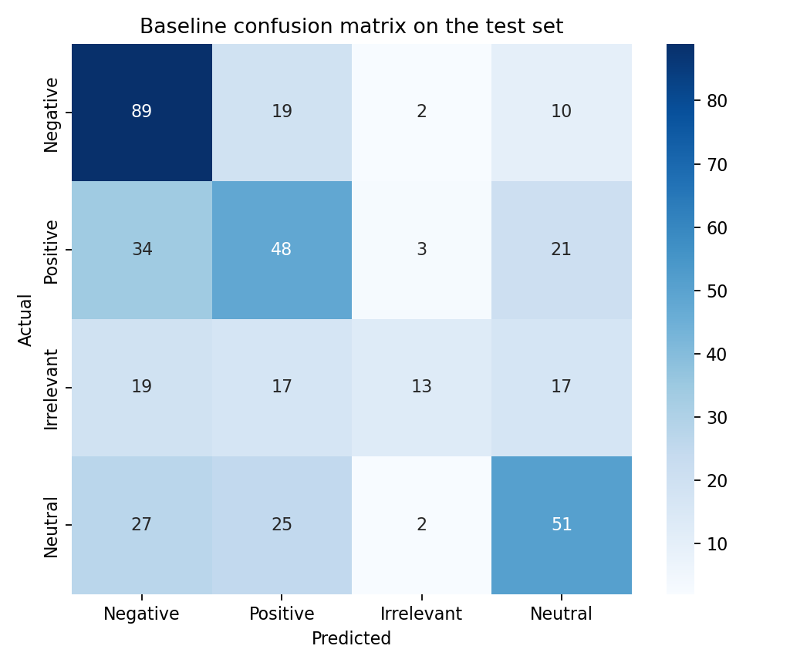

### 6.3 词权重与 EDA 结论互相印证

| 推往类别 | 高权重词 |
| --- | --- |
| Negative | fuck，not，shit，fix，atmention |
| Positive | love |
| Neutral | johnson，microsoft，amazon，news |
| Irrelevant | player，csgo |

权重方向与 5.4–5.7 节的类别画像完全一致（负面靠否定与点名、中性靠品牌、无关靠玩家词）。

### 6.4 重叠样本的影响

剔除那条训练/测试重叠且标签不一致的测试样本后：accuracy 0.508、macro-F1 0.467，与全测试集结果几乎无差别。**主分数使用全测试集即可。**

### 6.5 尚未纳入的能力

`exclaim_count`、`question_count`、`url_count`、`mention_count` 四个表层特征尚未加入该基线；类别权重与重采样亦留待后续。

---

## 7. 结论与后续建议

### 7.1 主要结论

1. **数据质量**：编码损坏是核心问题，修复后无空文本、正文信息基本保留；仅删除 5 行重复/泄漏样本，训练集 591 条、测试集 397 条可用于建模。
2. **分布一致性**：训练/测试为同一分布，可放心使用"训练学、测试评"范式。
3. **特征价值**：问号、`@`、网址、感叹号与情感类别存在中等关联且彼此正交，可作为有效特征；篇幅与类别无稳定关系，不建议作为特征。
4. **类别结构**：Irrelevant 因与正面共用游戏词而最难区分（recall 0.197），是后续优化的重点。
5. **基线水平**：TF-IDF + LR 达 accuracy 0.506 / macro-F1 0.466，远超多数类参照，具备可靠的比较基线。

### 7.2 后续建议

- **评估口径**：以 **macro-F1** 为主要指标，兼顾各分类别的 precision/recall，避免 accuracy 被多数类主导。
- **特征增强**：将四个表层特征（`exclaim/question/url/mention_count`）加入模型，观察增益。
- **类别处理**：对 Irrelevant 的类别不平衡可尝试类别权重或轻度重采样，并评估是否引入 `@` 账号、品牌词等结构化信号。
- **标签质量**：对 2.2 节标记的疑似错标样本（新闻式陈述被标 Negative）可做人工复核，作为标签噪声的分析材料。
- **数据分片**：评测时可将那条跨划分重叠样本单独报告，保持主指标纯净。

---

## 附录 A：文件清单

| 路径 | 内容 |
| --- | --- |
| `data/processed/train_cleaned.csv` | 清洗后训练集，591 行 |
| `data/processed/test_cleaned.csv` | 清洗后测试集，397 行 |
| `data/processed/removed_rows.csv` | 删除的 5 行及原因 |
| `figures/01`–`12` | 分布、相关、类别画像、区分词、词表重叠等 |
| `figures/13_baseline_confusion.png` | 基线在测试集上的混淆矩阵 |
| `reports/baseline_metrics.json` | 基线总体/分类别分数与词权重 |
| `reports/association_tests.csv` | 特征与类别的统计检验 |
| `reports/class_profile.csv` | 四类的篇幅、标点、游戏词与品牌词 |
| `reports/feature_correlation.csv` | 数值特征相关矩阵 |
| `reports/distinctive_words.csv` | 各类相对其余类更突出的词 |
| `reports/vocab_overlap.csv` | 类别词表 Jaccard |
| `reports/long_tweets.csv` | 超过长度阈值的原文 |
| `reports/cleaning_examples.csv` | 清洗前后对照 |
| `reports/eda_stats.json` / `extended_stats.json` | 计数、高频词、检验统计量 |
| `scripts/clean_and_analyze.py` | 清理主流程 + 前半 EDA |
| `scripts/extend_analysis.py` | 后半 EDA（相关、画像、区分词） |
| `models/kai/tfidf-lr/baseline_tfidf_lr.py` | TF-IDF + 逻辑回归基线 |

## 附录 B：数据口径与订正说明

- 本报告中「含网址」行数（训练集 122、测试集 88）、4.2 节网址占比（训练集 Neutral 38.4%、Negative 8.6%；测试集 Neutral 30.5%）等数字，均依据 `scripts/clean_and_analyze.py` 的输出与原始文件独立复核后订正。
- 所有比例均以对应划分内该类的推文数为分母计算；一词可同时计入多个特征。
